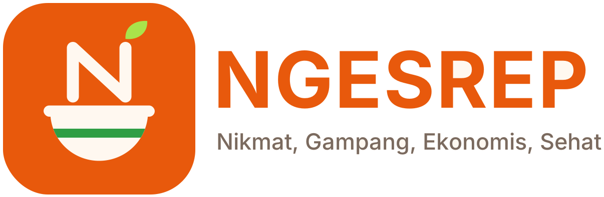
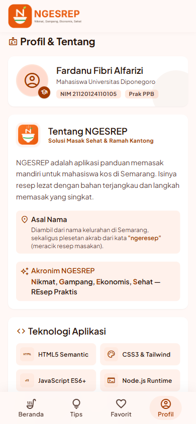

<p align="center">
  
</p>

<p align="center"><strong>Nikmat, Gampang, Ekonomis, Sehat</strong></p>

# NGESREP

Aplikasi resep masakan anak kos hemat berbasis **Progressive Web App (PWA)**. Berisi 15 resep
praktis dan 6 tips dapur, lengkap dengan pencarian, filter kategori, dan daftar favorit yang
tersimpan di perangkat.

## Asal Nama

NGESREP diambil dari nama kelurahan di Semarang, sekaligus plesetan dari kata **"ngeresep"**
(meracik resep masakan).

Akronim: **N**ikmat, **G**ampang, **E**konomis, **S**ehat — **RE**sep **P**raktis.

## Fitur

- Beranda: daftar resep dengan pencarian dan filter kategori (bisa digabung).
- Detail resep: bahan yang bisa dicentang dengan penghitung, langkah memasak, tombol favorit.
- Tips dapur: daftar tips dengan pencarian, plus detail tips dan "Tips Lainnya".
- Favorit: tersimpan di `localStorage`, tetap tampil saat offline.
- Profil: data pembuat dan penjelasan aplikasi.
- Akun: buka **Profil → Akun · Masuk / Daftar** untuk mendaftar, masuk, atau keluar.
- PWA: bisa di-install dan tetap menampilkan data yang pernah dibuka saat offline.

## Teknologi

| Bagian | Pilihan |
|---|---|
| Frontend | HTML, JavaScript murni (ES Modules), Tailwind CSS v3.4 (dikompilasi) |
| Backend | Node.js, Express 5, `@supabase/supabase-js` |
| Database | Supabase (PostgreSQL) |
| Hosting | API dan PWA: Vercel |

Font disajikan dari `pwa/fonts/`: Plus Jakarta Sans (SIL OFL) dan Material Symbols Outlined
(Apache 2.0). Font ikon telah diperkecil menjadi 33 ikon yang digunakan aplikasi. Jika
menambah nama ikon baru, perbarui subset dan versi cache. Kedua lisensi disertakan di folder font.

## Arsitektur

```
PWA (HTML + Tailwind terkompilasi + JS murni) --fetch HTTPS--> API Express (Vercel, CORS) --> Supabase (PostgreSQL)
```

PWA tidak mengakses Supabase secara langsung. Semua data lewat API sendiri.

## Endpoint API

| Method | Endpoint | Keterangan |
|---|---|---|
| GET | `/` | Cek API berjalan |
| GET | `/api/categories` | Semua kategori |
| GET | `/api/categories/:id` | Satu kategori |
| POST | `/api/categories` | Tambah kategori |
| PUT / DELETE | `/api/categories/:id` | Ubah / hapus kategori |
| GET | `/api/recipes` | Semua resep + nama kategori. Dukung `?category_id=` dan `?search=` |
| GET | `/api/recipes/:id` | Satu resep + nama kategori |
| POST | `/api/recipes` | Tambah resep |
| PUT / DELETE | `/api/recipes/:id` | Ubah / hapus resep |
| GET | `/api/tips` | Semua tips. Dukung `?search=` |
| GET | `/api/tips/:id` | Satu tips |
| POST | `/api/tips` | Tambah tips |
| PUT / DELETE | `/api/tips/:id` | Ubah / hapus tips |

Format sukses: JSON langsung (array/objek). Format error: `{ "error": "pesan" }`.
Operasi tulis katalog memerlukan header `Authorization: Bearer <ADMIN_API_KEY>`.
PWA tidak menyimpan atau mengirim kunci admin; gunakan hanya dari lingkungan tepercaya seperti
Postman. Jika `ADMIN_API_KEY` belum disetel, endpoint tulis akan mengembalikan `503`.

Akun pembaca tidak diberi izin tulis katalog. Endpoint akun: `POST /api/auth/register`,
`POST /api/auth/login`, `GET /api/auth/me`, `POST /api/auth/refresh`, dan `POST /api/auth/logout`.
PWA mengaksesnya melalui origin sendiri; sesi memakai cookie `HttpOnly`, bukan token di
`localStorage`. Katalog tetap publik dan favorit tetap tersimpan per browser, bukan per akun.

## Cara Menjalankan Lokal

### 1. Database

1. Buat proyek di [Supabase](https://supabase.com).
2. Buka SQL Editor, jalankan `api/sql/schema.sql`, lalu jalankan `api/sql/seed.sql` satu kali.
   Schema mengaktifkan RLS tanpa memberi akses tabel langsung ke peran publik; akses aplikasi
   dilakukan melalui API server.

**Database lama:** uji `api/sql/upgrade-rls.sql` pada salinan database, lalu jalankan hanya
skrip tersebut saat upgrade disetujui. Jangan ulangi schema atau seed. Skrip ini menghapus
policy lama pada tiga tabel katalog sebelum mengaktifkan RLS, karena akses aplikasi memakai
service role melalui API.

### 2. API

Gunakan Node.js 22 atau lebih baru. Isi `ADMIN_API_KEY` dengan rahasia acak milik sendiri;
biarkan kosong bila API hanya dipakai untuk membaca.

```bash
cd api
npm install
copy .env.example .env     # Windows (Linux/macOS: cp .env.example .env)
# isi SUPABASE_URL, SUPABASE_SERVICE_ROLE_KEY, SUPABASE_PUBLISHABLE_KEY, dan ADMIN_API_KEY di .env
npm run dev
```

API jalan di `http://localhost:3000`. Cek dengan membuka `http://localhost:3000/api/recipes`.
Untuk request tulis lokal, kirim header `Authorization: Bearer <ADMIN_API_KEY>`. Jangan masukkan
kunci service-role atau admin ke kode PWA, Git, atau browser.

### 3. PWA

```bash
cd pwa
npm install
npm run build:css          # menghasilkan css/style.css
```

Buka `http://localhost:3000/index.html` saat API lokal berjalan agar halaman akun dan
endpoint sesi berada pada origin yang sama. Server statis terpisah tidak menangani login.

`API_BASE_URL` di `pwa/js/config.js` menunjuk ke API produksi. Untuk pengembangan lokal,
ubah ke `http://localhost:3000`. Gunakan HTTPS atau localhost agar penyimpanan favorit lintas tab tersedia.

## Deploy

Aplikasi ini sudah ter-deploy dan berjalan:

| Layanan | URL |
|---|---|
| PWA | https://ngesrep-pwa.vercel.app |
| API (Vercel) | https://ngesrep-7xy6.vercel.app |

Cara deploy ulang dari nol:

1. **API ke Vercel:** import repository, set Root Directory `api`, isi environment variable
   `SUPABASE_URL`, `SUPABASE_SERVICE_ROLE_KEY`, dan `ADMIN_API_KEY`. Buat admin key acak dan
   simpan hanya di environment API; jangan set di project PWA. Tanpa admin key, tulis akan
   gagal tertutup dengan status `503`. Catat URL produksi.
2. Ganti `API_BASE_URL` di `pwa/js/config.js` dengan URL Vercel tersebut. Setiap perubahan
   aset PWA: jalankan `npm run build:css` dari `pwa/`, lalu `npm test`. Build memperbarui versi
   cache dari isi berkas; tes menolak versi lama. Sertakan CSS dan `sw.js` hasilnya dalam rilis.
3. **PWA ke Vercel:** import repository lagi, set Root Directory `pwa`, Framework Preset `Other`,
   tanpa build command (CSS sudah dikompilasi dan ikut di-commit).
4. Buka URL PWA di HP, uji install dan mode offline.

**Rilis akun:** isi `SUPABASE_PUBLISHABLE_KEY` (atau `SUPABASE_ANON_KEY`) pada proyek API,
aktifkan provider Email di Supabase, dan atur Site URL ke URL PWA. Dengan konfirmasi email
aktif, pembaca membuka tautan konfirmasi lalu kembali ke Profil → Akun untuk masuk.
Jika alamat API berubah, sesuaikan juga tujuan rewrite di `pwa/vercel.json`.
Endpoint akun meneruskan batas percobaan Supabase (`429`). Sebelum membuka pendaftaran umum,
cek batas dan pengiriman email di Supabase serta aktifkan rate limit platform pada
`/api/auth/login` dan `/api/auth/register`; jangan mengandalkan penghitung per proses Vercel.

## Struktur Folder

```
ngesrep/
├── README.md
├── docs/screenshots/        # tangkapan layar 6 halaman
├── design/                  # referensi visual hasil Google Stitch
├── api/
│   ├── sql/                 # schema.sql dan seed.sql
│   └── src/
│       ├── config/          # koneksi Supabase
│       ├── models/          # query database
│       ├── controllers/     # validasi dan response
│       └── routes/          # pemetaan URL
└── pwa/
    ├── index.html
    ├── manifest.json
    ├── sw.js
    ├── css/style.css        # hasil build Tailwind (di-commit)
    ├── js/
    │   ├── config.js        # API_BASE_URL dan data profil
    │   ├── api.js           # semua fetch ke API
    │   ├── favorites.js     # baca/tulis localStorage
    │   ├── router.js        # hash router
    │   ├── ui.js            # helper render
    │   ├── app.js           # titik masuk
    │   └── pages/           # 6 halaman
    ├── icons/
    └── images/
```

## Screenshot

| Beranda | Detail Resep | Tips Dapur |
|---|---|---|
|  |  |  |

| Detail Tips | Favorit | Profil |
|---|---|---|
|  |  |  |

Kredit dan lisensi foto resep/tips: [docs/kredit-foto.md](docs/kredit-foto.md).

## Pembuat

- Nama: Fardanu Fibri Alfarizi
- NIM: 21120124110105
- Kelas: Prak PPB
- Kampus: Universitas Diponegoro
