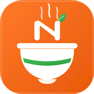
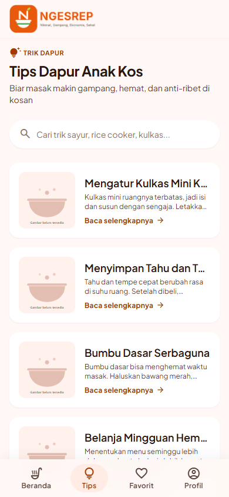
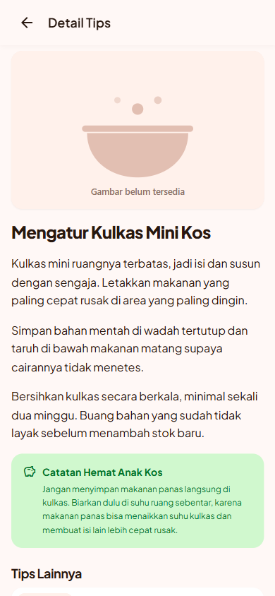

<p align="center">
  
</p>

<p align="center"><strong>Nikmat, Gampang, Ekonomis, Sehat</strong></p>

# NGESREP

Aplikasi resep masakan anak kos hemat berbasis **Progressive Web App (PWA)**. Berisi 15 resep
praktis dan 6 tips dapur, lengkap dengan pencarian, filter kategori, dan daftar favorit.

## Asal Nama

NGESREP diambil dari nama kelurahan di Semarang, sekaligus plesetan dari kata **"ngeresep"**
(meracik resep masakan).

Akronim: **N**ikmat, **G**ampang, **E**konomis, **S**ehat — **RE**sep **P**raktis.

## Fitur

- Beranda: daftar resep dengan pencarian dan filter kategori (bisa digabung).
- Detail resep: bahan yang bisa dicentang dengan penghitung, langkah memasak, tombol favorit.
- Tips dapur: daftar tips dengan pencarian, plus detail tips dan "Tips Lainnya".
- Favorit: favorit tamu tersimpan di perangkat; favorit akun disinkronkan ke Supabase
  dan dapat dilihat offline dari salinan di perangkat.
- Profil: data pembuat dan penjelasan aplikasi.
- Akun: buka **Profil → Akun · Masuk / Daftar** untuk mendaftar, masuk, atau keluar.
- PWA: bisa di-install dan tetap menampilkan data yang pernah dibuka saat offline.

## Teknologi

| Bagian | Pilihan |
|---|---|
| Frontend | HTML, JavaScript murni (ES Modules), Tailwind CSS v3.4 (dikompilasi) |
| Backend | Node.js, Express 5, `@supabase/supabase-js` |
| Database | Supabase (PostgreSQL) |
| Hosting | API dan PWA: Vercel |

Font disajikan dari `pwa/fonts/`: Plus Jakarta Sans (SIL OFL) dan Material Symbols Outlined
(Apache 2.0). Font ikon telah diperkecil menjadi 33 ikon yang digunakan aplikasi. Jika
menambah nama ikon baru, perbarui subset dan versi cache. Kedua lisensi disertakan di folder font.

## Arsitektur

```
PWA (HTML + Tailwind terkompilasi + JS murni) --fetch HTTPS--> API Express (Vercel, CORS) --> Supabase (PostgreSQL)
```

PWA tidak mengakses Supabase secara langsung. Semua data lewat API sendiri.

## Endpoint API

| Method | Endpoint | Keterangan |
|---|---|---|
| GET | `/` | Cek API berjalan |
| GET | `/api/categories` | Semua kategori |
| GET | `/api/categories/:id` | Satu kategori |
| POST | `/api/categories` | Tambah kategori |
| PUT / DELETE | `/api/categories/:id` | Ubah / hapus kategori |
| GET | `/api/recipes` | Semua resep + nama kategori. Dukung `?category_id=` dan `?search=` |
| GET | `/api/recipes/:id` | Satu resep + nama kategori |
| POST | `/api/recipes` | Tambah resep |
| PUT / DELETE | `/api/recipes/:id` | Ubah / hapus resep |
| GET | `/api/tips` | Semua tips. Dukung `?search=` |
| GET | `/api/tips/:id` | Satu tips |
| POST | `/api/tips` | Tambah tips |
| PUT / DELETE | `/api/tips/:id` | Ubah / hapus tips |

Format sukses: JSON langsung (array/objek). Format error: `{ "error": "pesan" }`.
Endpoint katalog langsung tetap membaca secara publik. Operasi tulis langsung (mis. Postman)
memerlukan `Authorization: Bearer <ADMIN_API_KEY>`. Jika kunci belum disetel, operasi tulis
mengembalikan `503`.

### Kelola Katalog

Buka **Profil → Akun · Masuk / Daftar**. Pembaca dan admin masuk lewat form yang sama.
Jika akun memiliki akses admin, Beranda menampilkan **Tambah Resep**, **Ubah**, dan **Hapus**.
API memverifikasi akun dan role pada setiap request `/api/auth/admin/*` menggunakan sesi
akun `HttpOnly` yang sama dengan favorit. Akun yang mendaftar dari aplikasi tidak diberi role admin.
Gunakan **Keluar** di halaman Akun untuk mengakhiri sesi.
Tips dan kategori tidak punya UI admin di PWA; keduanya tetap bisa dikelola lewat API tulis langsung.
Penghapusan kategori tidak menghapus resep; resep terkait menjadi tanpa kategori.

**Siapkan akun admin:** di Supabase Authentication, buat atau pilih akun dengan email
terkonfirmasi. Dari lingkungan server tepercaya, gunakan Supabase Auth Admin API
(`supabase.auth.admin.updateUserById(userId, { app_metadata: { role: "admin" } })` dengan
client service role). Penanda harus di `app_metadata`, bukan `user_metadata`. Uji di proyek
pengujian sebelum menyiapkan akun produksi. Tidak perlu tabel atau migrasi admin.

`ADMIN_API_KEY` tetap hanya di server untuk request tulis langsung via Bearer, bukan
untuk login admin. Pencabutan role memblokir request admin berikutnya.

Foto resep dan tips diunggah lewat API ke Supabase Storage. Siapkan bucket publik bernama
`resep` pada **proyek pengujian** terlebih dahulu; izinkan JPEG, PNG, dan WebP hingga 2 MB.
Jangan beri kebijakan tulis Storage kepada pengguna biasa. API menggunakan service role
yang tidak dikirim ke browser. Foto dalam bucket publik dapat dibuka siapa pun yang punya
URL-nya. Untuk versi ini, bersihkan foto lama atau unggahan yang tidak terpakai secara manual
setelah memastikan foto tidak lagi dirujuk katalog.

Akun pembaca tidak diberi izin tulis katalog. Endpoint akun: `POST /api/auth/register`,
`POST /api/auth/login`, `GET /api/auth/me`, `POST /api/auth/refresh`, dan `POST /api/auth/logout`.
PWA mengaksesnya melalui origin sendiri; sesi memakai cookie `HttpOnly`, bukan token di
`localStorage`. Katalog tetap publik.

Favorit tamu disimpan di browser. Setelah masuk, favorit tamu digabung ke akun dan tersedia
di perangkat lain. Saat offline, pengguna yang masuk dapat melihat daftar tersimpan,
tetapi perubahan favorit akun memerlukan koneksi. Keluar menghapus salinan akun dari
perangkat, bukan dari database.

- `GET /api/auth/favorites` — daftar favorit akun yang sedang masuk.
- `PUT /api/auth/favorites/:id` — simpan resep; aman diulang.
- `DELETE /api/auth/favorites/:id` — hapus resep dari favorit.

Endpoint favorit menggunakan cookie sesi pembaca, bukan kunci admin. Operasi tulis juga
memerlukan `X-Favorites-User` berisi ID sesi yang ditampilkan API, agar tab lama tidak
menulis ke akun yang berbeda. ID pengguna untuk query selalu diambil dari sesi terverifikasi.

## Cara Menjalankan Lokal

### 1. Database

1. Buat proyek di [Supabase](https://supabase.com).
2. Buka SQL Editor, jalankan `api/sql/schema.sql`, lalu jalankan `api/sql/seed.sql` satu kali.
   Schema mengaktifkan RLS tanpa memberi akses tabel langsung ke peran publik; akses aplikasi
   dilakukan melalui API server.

**Database lama:** uji `api/sql/upgrade-rls.sql` pada salinan database, lalu jalankan hanya
skrip tersebut saat upgrade disetujui. Jangan ulangi schema atau seed. Skrip ini menghapus
policy lama pada tiga tabel katalog sebelum mengaktifkan RLS, karena akses aplikasi memakai
service role melalui API.

Untuk database yang sudah ada, siapkan favorit per akun dengan `api/sql/upgrade-favorites.sql`.
Uji migrasi dan alur dua akun di proyek Supabase pengujian sebelum merilis fitur.

### 2. API

Gunakan Node.js 22 atau lebih baru. Isi `ADMIN_API_KEY` dengan rahasia acak milik sendiri;
biarkan kosong bila API hanya dipakai untuk membaca.

```bash
cd api
npm install
copy .env.example .env     # Windows (Linux/macOS: cp .env.example .env)
# isi SUPABASE_URL, SUPABASE_SERVICE_ROLE_KEY, SUPABASE_PUBLISHABLE_KEY, dan ADMIN_API_KEY di .env
npm run dev
```

API jalan di `http://localhost:3000`. Cek dengan membuka `http://localhost:3000/api/recipes`.
Untuk request tulis langsung, kirim header `Authorization: Bearer <ADMIN_API_KEY>`.
Jangan masukkan kunci service-role atau admin ke kode PWA atau Git.

### 3. PWA

```bash
cd pwa
npm install
npm run build:css          # menghasilkan css/style.css
```

Buka `http://localhost:3000/index.html` untuk PWA, lalu **Profil → Akun · Masuk / Daftar**.
Server statis terpisah tidak menangani login.

Di `localhost` atau `127.0.0.1`, PWA memakai API di alamat yang sama; selain itu,
`API_BASE_URL` di `pwa/js/config.js` menunjuk ke API produksi. Gunakan HTTPS atau localhost
agar sinkronisasi sesi dan favorit lintas tab dapat memakai Web Locks.
Untuk mencoba CRUD admin, gunakan `localhost` atau set `ADMIN_ORIGIN` sesuai alamat yang dibuka.

## Deploy

Aplikasi ini sudah ter-deploy dan berjalan:

| Layanan | URL |
|---|---|
| PWA | https://ngesrep.vercel.app |
| API (Vercel) | https://ngesrep-7xy6.vercel.app |

Cara deploy ulang dari nol:

1. **API ke Vercel:** import repository, set Root Directory `api`, isi environment variable
   `SUPABASE_URL`, `SUPABASE_SERVICE_ROLE_KEY`, dan `ADMIN_API_KEY`. Buat admin key acak dan
   simpan hanya di environment API; jangan set di project PWA. Tanpa admin key, tulis akan
   gagal tertutup dengan status `503`. Catat URL produksi.
2. Ganti `API_BASE_URL` di `pwa/js/config.js` dengan URL Vercel tersebut. Setiap perubahan
   aset PWA: jalankan `npm run build:css` dari `pwa/`, lalu `npm test`. Build memperbarui versi
   cache dari isi berkas; tes menolak versi lama. Sertakan CSS dan `sw.js` hasilnya dalam rilis.
3. **PWA ke Vercel:** import repository lagi, set Root Directory `pwa`, Framework Preset `Other`,
   tanpa build command (CSS sudah dikompilasi dan ikut di-commit).
4. Buka URL PWA di HP, uji install dan mode offline.

**Cek sebelum demo** (uji perubahan data di lingkungan pengujian):

- Masuk sebagai pembaca lewat Profil. Pastikan tombol **Tambah Resep**, **Ubah**, dan
  **Hapus** tidak muncul di Beranda. Keluar, lalu masuk lewat form yang sama sebagai admin.
- Sebagai admin, tambahkan satu resep uji dengan foto, ubah, lalu hapus. Pastikan daftar
  Beranda mencerminkan masing-masing perubahan.
- Masuk dengan akun yang sama di dua browser. Simpan satu resep di browser pertama,
  buka Favorit di browser kedua, lalu hapus favorit itu. Muat ulang Favorit di browser
  pertama dan pastikan resep sudah tidak ada di daftar favorit.

**Rilis akun:** isi `SUPABASE_PUBLISHABLE_KEY` (atau `SUPABASE_ANON_KEY`) pada proyek API,
aktifkan provider Email di Supabase, dan atur Site URL ke URL PWA. Dengan konfirmasi email
aktif, pembaca membuka tautan konfirmasi lalu kembali ke Profil → Akun untuk masuk.
Jika alamat API berubah, sesuaikan juga tujuan rewrite di `pwa/vercel.json`.
API admin menerima request tulis dari `https://ngesrep.vercel.app` dan
`https://ngesrep-pwa.vercel.app` di Vercel secara bawaan. Untuk domain lain, set `ADMIN_ORIGIN` pada proyek API ke origin PWA
yang tepat (tanpa garis miring penutup). Sebelum mengaktifkan fitur di produksi,
siapkan bucket `resep` dengan pengaturan di atas. Jangan arahkan pengujian CRUD ke database produksi.
Endpoint akun meneruskan batas percobaan Supabase (`429`). Sebelum membuka pendaftaran umum,
cek batas dan pengiriman email di Supabase serta aktifkan rate limit platform pada
`/api/auth/login` dan `/api/auth/register`; jangan mengandalkan penghitung per proses Vercel.

## Struktur Folder

```
ngesrep/
├── README.md
├── docs/screenshots/        # tangkapan layar 6 halaman
├── design/                  # referensi visual hasil Google Stitch
├── api/
│   ├── sql/                 # schema.sql dan seed.sql
│   └── src/
│       ├── config/          # koneksi Supabase
│       ├── models/          # query database
│       ├── controllers/     # validasi dan response
│       └── routes/          # pemetaan URL
└── pwa/
    ├── index.html
    ├── manifest.json
    ├── sw.js
    ├── css/style.css        # hasil build Tailwind (di-commit)
    ├── js/
    │   ├── config.js        # API_BASE_URL dan data profil
    │   ├── api.js           # semua fetch ke API
    │   ├── favorites.js     # baca/tulis localStorage
    │   ├── router.js        # hash router
    │   ├── ui.js            # helper render
    │   ├── app.js           # titik masuk
    │   └── pages/           # 6 halaman
    ├── icons/
    └── images/
```

## Screenshot

| Beranda | Detail Resep | Tips Dapur |
|---|---|---|
|  |  |  |

| Detail Tips | Favorit | Profil |
|---|---|---|
|  |  |  |

Kredit dan lisensi foto resep/tips: [docs/kredit-foto.md](docs/kredit-foto.md).

## Pembuat

- Nama: Fardanu Fibri Alfarizi
- NIM: 21120124110105
- Kelas: Prak PPB
- Kampus: Universitas Diponegoro
