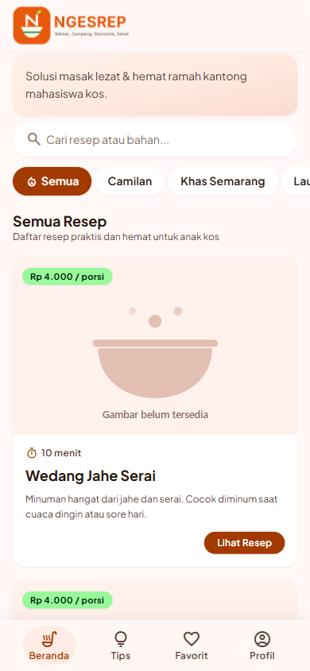
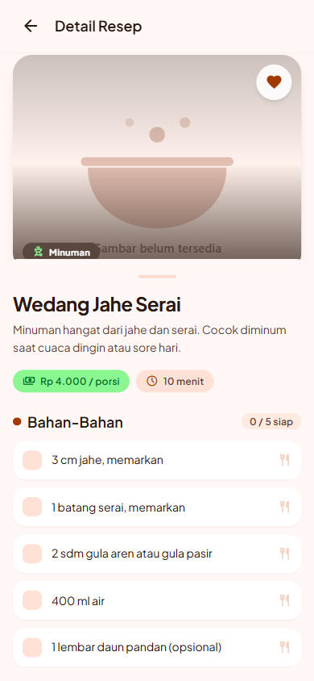
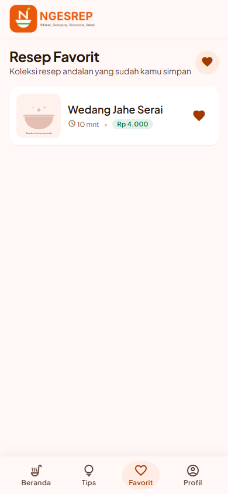

<p align="center">
  
</p>

<p align="center"><strong>Nikmat, Gampang, Ekonomis, Sehat</strong></p>

# NGESREP

Aplikasi resep masakan anak kos hemat berbasis **Progressive Web App (PWA)**. Berisi 15 resep
praktis dan 6 tips dapur, lengkap dengan pencarian, filter kategori, dan daftar favorit yang
tersimpan di perangkat.

## Asal Nama

NGESREP diambil dari nama kelurahan di Semarang, sekaligus plesetan dari kata **"ngeresep"**
(meracik resep masakan).

Akronim: **N**ikmat, **G**ampang, **E**konomis, **S**ehat — **RE**sep **P**raktis.

## Fitur

- Beranda: daftar resep dengan pencarian dan filter kategori (bisa digabung).
- Detail resep: bahan yang bisa dicentang dengan penghitung, langkah memasak, tombol favorit.
- Tips dapur: daftar tips dengan pencarian, plus detail tips dan "Tips Lainnya".
- Favorit: tersimpan di `localStorage`, tetap tampil saat offline.
- Profil: data pembuat dan penjelasan aplikasi.
- PWA: bisa di-install dan tetap menampilkan data yang pernah dibuka saat offline.

## Teknologi

| Bagian | Pilihan |
|---|---|
| Frontend | HTML, JavaScript murni (ES Modules), Tailwind CSS v3.4 (dikompilasi) |
| Backend | Node.js, Express 5, `@supabase/supabase-js` |
| Database | Supabase (PostgreSQL) |
| Hosting | API: Vercel, PWA: Netlify atau GitHub Pages |

## Arsitektur

```
PWA (HTML + Tailwind terkompilasi + JS murni) --fetch HTTPS--> API Express (Vercel, CORS) --> Supabase (PostgreSQL)
```

PWA tidak mengakses Supabase secara langsung. Semua data lewat API sendiri.

## Endpoint API

| Method | Endpoint | Keterangan |
|---|---|---|
| GET | `/` | Cek API berjalan |
| GET | `/api/categories` | Semua kategori |
| GET | `/api/categories/:id` | Satu kategori |
| POST / PUT / DELETE | `/api/categories` | CRUD kategori |
| GET | `/api/recipes` | Semua resep + nama kategori. Dukung `?category_id=` dan `?search=` |
| GET | `/api/recipes/:id` | Satu resep + nama kategori |
| POST / PUT / DELETE | `/api/recipes` | CRUD resep |
| GET | `/api/tips` | Semua tips. Dukung `?search=` |
| GET | `/api/tips/:id` | Satu tips |
| POST / PUT / DELETE | `/api/tips` | CRUD tips |

Format sukses: JSON langsung (array/objek). Format error: `{ "error": "pesan" }`.

## Cara Menjalankan Lokal

### 1. Database

1. Buat proyek di [Supabase](https://supabase.com).
2. Buka SQL Editor, jalankan `api/sql/schema.sql`, lalu `api/sql/seed.sql`.

### 2. API

```bash
cd api
npm install
copy .env.example .env     # Windows (Linux/macOS: cp .env.example .env)
# isi SUPABASE_URL dan SUPABASE_KEY di .env
npm run dev
```

API jalan di `http://localhost:3000`. Cek dengan membuka `http://localhost:3000/api/recipes`.

### 3. PWA

```bash
cd pwa
npm install
npm run build:css          # menghasilkan css/style.css
```

Sajikan folder `pwa/` lewat server statis (contoh: ekstensi Live Server, atau
`npx serve .`), lalu buka `http://localhost:8080`.

`API_BASE_URL` di `pwa/js/config.js` dan `pwa/sw.js` saat ini menunjuk ke API produksi. Untuk
mengembangkan dengan API lokal, ubah keduanya ke `http://localhost:3000`.

## Deploy

Aplikasi ini sudah ter-deploy dan berjalan:

| Layanan | URL |
|---|---|
| PWA | https://ngesrep-pwa.vercel.app |
| API (Vercel) | https://ngesrep-7xy6.vercel.app |

Cara deploy ulang dari nol:

1. **API ke Vercel:** import repository, set Root Directory `api`, isi environment variable
   `SUPABASE_URL` dan `SUPABASE_KEY` (pakai service role key karena RLS aktif dan API yang
   menangani tulis). Catat URL produksi.
2. Ganti `API_BASE_URL` di `pwa/js/config.js` dan `pwa/sw.js` dengan URL Vercel tersebut.
3. **PWA ke Vercel:** import repository lagi, set Root Directory `pwa`, Framework Preset `Other`,
   tanpa build command (CSS sudah dikompilasi dan ikut di-commit).
4. Buka URL PWA di HP, uji install dan mode offline.

## Struktur Folder

```
ngesrep/
├── README.md
├── docs/screenshots/        # tangkapan layar 6 halaman
├── design/                  # referensi visual hasil Google Stitch
├── api/
│   ├── sql/                 # schema.sql dan seed.sql
│   └── src/
│       ├── config/          # koneksi Supabase
│       ├── models/          # query database
│       ├── controllers/     # validasi dan response
│       └── routes/          # pemetaan URL
└── pwa/
    ├── index.html
    ├── manifest.json
    ├── sw.js
    ├── css/style.css        # hasil build Tailwind (di-commit)
    ├── js/
    │   ├── config.js        # API_BASE_URL dan data profil
    │   ├── api.js           # semua fetch ke API
    │   ├── favorites.js     # baca/tulis localStorage
    │   ├── router.js        # hash router
    │   ├── ui.js            # helper render
    │   ├── app.js           # titik masuk
    │   └── pages/           # 6 halaman
    ├── icons/
    └── images/
```

## Screenshot

| Beranda | Detail Resep | Tips Dapur |
|---|---|---|
|  |  |  |

| Detail Tips | Favorit | Profil |
|---|---|---|
|  |  |  |

## Pembuat

- Nama: Fardanu Fibri Alfarizi
- NIM: 21120124110105
- Kelas: Prak PPB
- Kampus: Universitas Diponegoro
